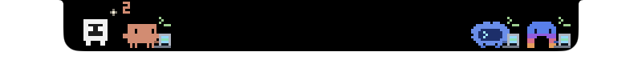
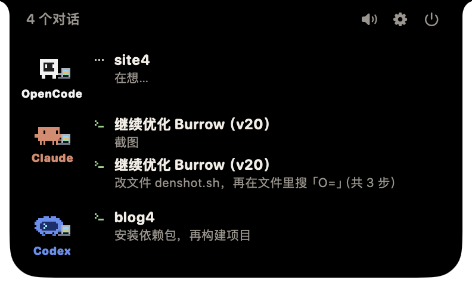
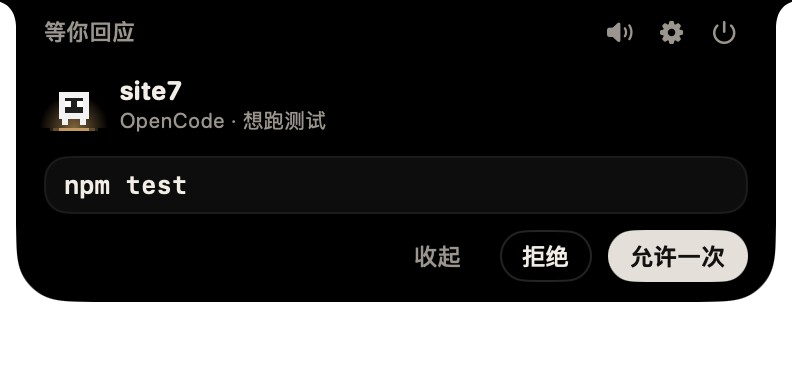
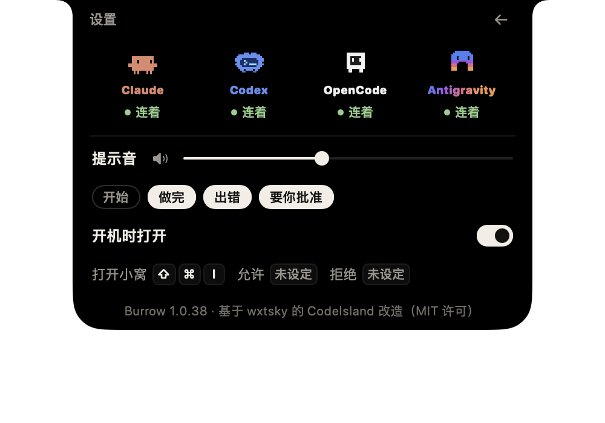

# Burrow

The MacBook notch is a burrow, and your coding agents live in it.

Each agent — Claude Code, Codex, OpenCode, Antigravity — has a small pixel pet that peeks out from behind the notch while it works. A pet with news steps out. One that needs you gets a night light at its feet. A turn that failed leaves an ember by the pet, and a finished one a spark, until you look.

<p align="center"></p>

Hover the notch and the pets fly into the den: one block per agent, every conversation in two lines — its title, and what it is doing right now.

<p align="center"></p>

When an agent asks to run a command, the card shows the command in the biggest type, marks the dangerous words, and says in one plain line what it will do. Allow it once, or deny it.

<p align="center"></p>

The gear turns the den over. Its back is all the settings there are: which agents are connected, the sounds, opening at login, and shortcuts.

<p align="center"></p>

## Build

macOS 14 or later, Xcode installed.

```sh
DEVELOPER_DIR=/Applications/Xcode.app/Contents/Developer ./build.sh
```

The app is `.build/release/Burrow.app`; move it to `/Applications`. Burrow adds its hooks to the agents it finds; you can reconnect or unplug each one on the back of the den.

## Credits

- Burrow began as a fork of [CodeIsland](https://github.com/wxtsky/CodeIsland) by wxtsky (MIT).
- The pixel pets are drawn after [claude-desktop-buddy](https://github.com/anthropics/claude-desktop-buddy) (MIT).
- Claude Code, Codex, OpenCode and Antigravity, and their icons, belong to their owners. Burrow is not affiliated with any of them.

## 中文

刘海是一个洞，你的编程 agent 住在里面。Claude Code、Codex、OpenCode、Antigravity 各有一只像素小宠物，干活时从刘海后面探出头；有消息的走出来，需要你的脚下亮一盏夜灯。鼠标移到刘海上，小窝打开，每个对话两行：标题和它正在做什么。批准卡把命令写得最大，危险的词标红，下面一行说清它要做什么。点齿轮，小窝翻到背面，就是全部设置。

构建见上面的 Build，MIT 许可。

## License

MIT — see [LICENSE](LICENSE).
